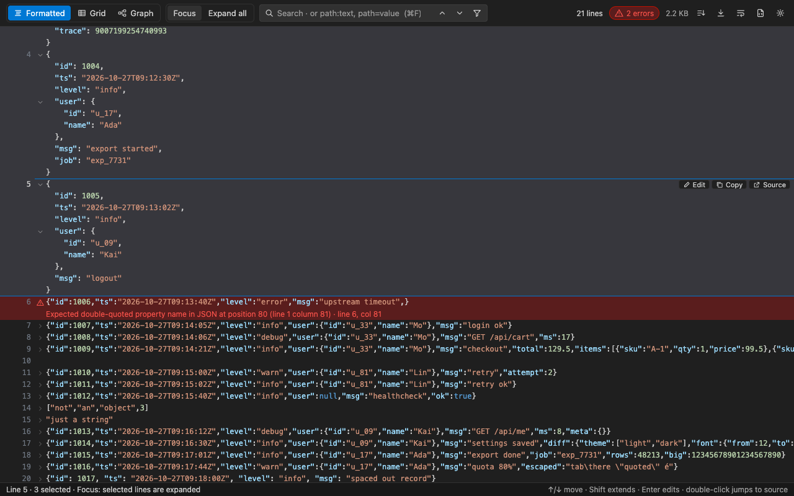
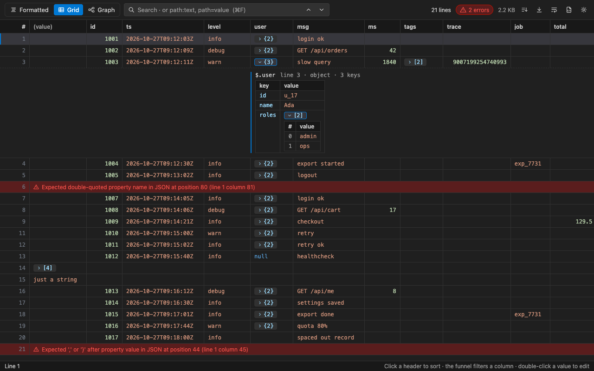
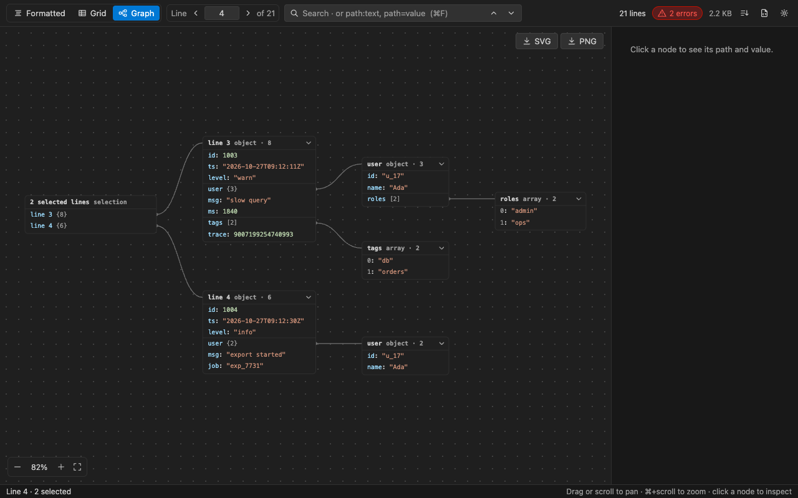

# Better JSONL

**One file, three views.** View JSON and JSON Lines (`.jsonl`, `.ndjson`) as formatted cards, a nested grid, or a node graph — side by side with your editor and synced to your cursor.



## Install

Download `better-jsonl-<version>.vsix` from the [GitHub Releases](../../releases) page, then either:

- In VS Code: Extensions view → `…` menu → **Install from VSIX…**, or
- In a terminal: `code --install-extension better-jsonl-<version>.vsix`

## Features

### Formatted view (default)

- **JSONL Focus mode** — every line stays on one line, and only the current or selected lines are pretty-printed. Move the cursor in the text editor and the preview follows.
- **JSONL Expand all mode** — every line is pretty-printed.
- Fold and unfold any object or array.
- Invalid lines get a red mark with the line and column of the error. Other lines are not affected.
- Large integers (for example `9007199254740993`) are shown exactly as written.
- Edit one record in a pretty-printed editor. It is saved back as one compact line.
- Double-click any line to jump to that member in the source.
- **Word wrap**: press `Alt+Z` (`Option+Z` on macOS) in the view, or use the wrap button in the toolbar. Wrapped parts of a pretty line keep its indent.
- **Follow** (the arrow button, JSON Lines): the view stays at the last line while lines are added, like `tail -f`.
- **Compare**: select two lines, then press the compare button. A panel lists the differences field by field (added, removed, changed); **Open in the diff editor** shows the two records side by side in VS Code.
- **Export** (the download button): the lines on screen (all lines, or the search result) or the selected lines, as JSON Lines (the raw lines) or CSV (one column per key, UTF-8 with a byte order mark).

### Grid view

- One row per record. The columns are all top-level keys.
- Nested objects and arrays open as sub-grids under the row, starting under the column you opened. Arrays of objects show as tables.
- Word wrap (`Alt+Z`) wraps long cell values.
- Sort by any column. Drag a header edge to resize.
- Filter by any column: the funnel button in a header lists the column's values with counts. Untick values, or type to keep only cells that contain the text. Filters on several columns combine, and each value list follows the other filters.
- Column statistics at the top of the filter popup: the types and their counts, the number of distinct values, min / max / mean of the numbers, and the shortest and longest text.
- **Edit a cell**: double-click a value (text, number, true / false / null). `Enter` writes it, `Esc` cancels. Only that value changes in the file: the rest of the line or document stays as it is. A text cell stays text; in another cell type a JSON value (`"…"` makes text).
- Export the rows on screen (after search, filters and sort) as JSON Lines or CSV.



### Graph view

- Objects and arrays are nodes. Nested values are child nodes, linked from their row.
- Pan, zoom, fit, fold nodes, and search.
- Click a node to see its JSONPath and value. Reveal it in the editor, or copy it.
- Select several JSONL lines to compare them in one graph.
- Export as SVG or PNG.
- An overview in the corner shows the whole graph when it does not fit; click or drag in it to move the view.



### Large and compressed files

VS Code does not give extensions the text of a file above 50 MB, and has no text view for compressed files. Better JSONL reads these files from disk itself, in their own panel:

- A JSON Lines file shows while it loads: the first rows are there at once, and you can scroll, select and search as the rest arrives. A 300 MB file with 3.4 million lines takes about 8 seconds to load and scan on a recent laptop.
- Only the lines on screen are decoded and parsed. Search runs in the background and shows its progress. In the Grid, sorting and column filters first read the columns they need (the status bar shows the progress).
- **Edit a record** of a large UTF-8 JSON Lines file (the record editor or a grid cell): the line is replaced on disk. The edit is refused when the file or the line changed since it was read.
- **Follow**: when a file only grows at its end (a log), the new lines are added to the view without reading the file again. Without follow mode, a **Load new lines** button appears. Other changes show a **Reload** button.
- **Compressed files**: `.jsonl.gz`, `.ndjson.gz` and `.json.gz` open in Better JSONL when you open them in VS Code. They are read-only.
- **Encodings**: a UTF-16 byte order mark is read, and so is the `files.encoding` setting (for example `gbk`, `shiftjis`, `windows1252`). Files that are not UTF-8 are read-only.
- One large JSON value (for example a 300 MB array) is parsed once, then opens with its members folded. A value above about 512 MB (too long for one JavaScript string) is parsed from the bytes; it needs enough memory for the parsed value.
- What is different: no cursor sync; **Expand all** is off above 50 MB. **Source** opens the file in VS Code at that line.

### Search and filter

Type plain text, a path query, or a jq or JSONPath query:

| Query | Meaning |
|-------|---------|
| `timeout` | Lines that contain the text |
| `level=warn` | `level` equals `warn` |
| `user.name:ada` | `user.name` contains `ada` |
| `ms>100` | Numeric compare (`>` or `<`) |
| `level!=info` | Not equal |
| `.level == "warn" and .ms > 100` | **jq** (a search that starts with `.`): records for which the filter gives something other than `false` or `null` |
| `select(.tags \| index("x"))` … `.user.name \| test("^a"; "i")` | jq functions: `select`, `map`, `has`, `length`, `keys`, `type`, `test`, `contains`, `startswith`, `endswith`, `any`, `all`, `sort_by`, `group_by`, `unique`, `min`, `max`, `add`, `to_entries`, `paths`, `path`, `if … then … else … end`, `//`, `?` and more |
| `$..user[?@.name == "Ada"]` | **JSONPath** (RFC 9535, a search that starts with `$`): filters, `..`, `*`, slices, unions, `length()`, `count()`, `match()`, `search()`. On JSON Lines, `$[?…]` tests each record |

The counter says when the search is jq or JSONPath. A query that is not valid is searched as text, and the status bar says why. jq here has no variables (`as $x`), `reduce` or assignment.

In the Formatted view, the filter button shows only the matching lines.

In one JSON document (not JSON Lines), jq and JSONPath results are places in the document: `Enter` goes to each one. A result that is computed (for example `.rows | length`) shows in the status bar. Plain text search also reads the whole value, so it also finds text inside folded nodes. The counter shows the matches (`1,000+` when there are more), and `Enter` / `Shift+Enter` go to the next or previous one. Only the nodes on the way to that match are opened.

### Keyboard

- `Cmd/Ctrl+F` goes to the search box; `Enter` and `Shift+Enter` step through the matches.
- JSON Lines: `↑` / `↓` move the current line, `Shift` extends the selection, `Enter` edits the record, `Cmd/Ctrl+C` copies the selected lines.
- `Tab` reaches every control. Fold arrows: `Enter` or `Space`. Grid headers: `Enter` sorts.
- Graph nodes: `Enter` selects (the inspector shows the node), `←` folds, `→` unfolds; `+`, `-` and `0` zoom in, zoom out and fit.

### Settings panel

Click the gear at the top right of the view. The panel changes the same settings as the VS Code Settings editor. A change is saved to your user settings, or to the workspace settings when the workspace sets that value:

- **Theme**: Follow VS Code, Light, Dark, or Follow system (the operating system's light or dark mode).
- **Word wrap**: Follow editor (`editor.wordWrap`), On, or Off.
- **Language**: Follow VS Code, English, or 简体中文 (Simplified Chinese). Right-click menus and the VS Code Settings editor always use the VS Code display language; they are translated through `package.nls.zh-cn.json`.
- Indent, default view, default JSON Lines mode, graph node limit, editor sync, Format Document for JSONL, and the Expand Selected Lines reminder.

## How to open

Right-click inside a JSON/JSONL editor, on its tab, or on the file in the Explorer. The commands are at the top level of the menu:

| Command | What it does |
|---------|--------------|
| **Better JSONL: Open Preview to the Side** | Opens the viewer beside the text editor. It follows the active JSON/JSONL editor and syncs the cursor. Also: the prism button at the top right of the editor (it is placed first, so a full title bar does not hide it), or `Cmd/Ctrl+K J`. |
| **Better JSONL: Open Full View** | Opens the viewer in place of the text editor. Save and undo still work. |

All commands are also in the Command Palette under `Better JSONL: …`.

## Commands for the text editor

| Command | What it does |
|---------|--------------|
| **Better JSONL: Expand Selected Lines** (right-click menu) | Pretty-prints the selected lines in place (each line that is a JSON value). It uses the editor's own indentation (Tab Size, spaces or tabs). A reminder then offers **Compact Lines**; choose **Don't Show Again** to turn it off. |
| **Better JSONL: Compact Lines** (right-click menu) | Turns the selections (or the whole file) back into one record per line. Blank lines stay. Nothing changes if any record is invalid. |

Both commands are in the right-click menu and the Command Palette for JSON and JSON Lines files. In a `.json` file, Compact Lines with no selection makes the whole document one compact line.
| **Format Document** on a `.jsonl` file | Off by default: Format Document does not change JSONL files. Turn on `betterJsonl.formatDocument.enabled` to make each line compact and canonical. It never expands records, because that would break the JSONL format. |

## Settings

| Setting | Default | Description |
|---------|---------|-------------|
| `betterJsonl.defaultView` | `formatted` | The first view: `formatted`, `grid` or `graph`. |
| `betterJsonl.theme` | `vscode` | `vscode` (follow VS Code), `light`, `dark`, or `system` (follow the operating system). |
| `betterJsonl.language` | `auto` | `auto` (follow the VS Code display language), `en`, or `zh-cn`. |
| `betterJsonl.wordWrap` | `followEditor` | `followEditor` (use `editor.wordWrap`), `on`, or `off`. `Alt+Z` toggles it in the open view. |
| `betterJsonl.jsonl.expandMode` | `focus` | `focus` or `all`. |
| `betterJsonl.indent` | `2` | Spaces per indent level in the viewer and the record editor. |
| `betterJsonl.graph.maxNodes` | `1500` | The graph stops adding nodes after this number. |
| `betterJsonl.preview.followActiveEditor` | `true` | The preview switches to the JSON/JSONL editor that becomes active. |
| `betterJsonl.syncSelection` | `true` | Sync the current line between the text editor and the view. |
| `betterJsonl.expandLines.showReminder` | `true` | After Expand Selected Lines, remind that the file is not valid JSONL until compacted. |
| `betterJsonl.formatDocument.enabled` | `false` | Let Format Document compact each line of a JSONL file. When off, Format Document does not change JSONL files. |

## Limits

- Files above 50 MB can be edited record by record when they are UTF-8 JSON Lines; other large and compressed files are read-only (see "Large and compressed files").
- A limit that hides data (300 grid columns, 10 lines in one graph, 2 000 selected lines) is named in the status bar when it applies.
- `.json` files with comments or trailing commas are parsed as JSON with Comments.
- A `.json` file with one JSON value per line is shown as JSON Lines.

## Development

```bash
npm install
npm run build        # dist/extension.js, dist/webview.js, dist/webview.css
npm run test:unit    # unit and property tests (node --test)
npm test             # unit tests, then all E2E tests
npm run test:e2e     # VS Code host tests + packaged-VSIX UI checks + webview tests in Chrome → test-results/report.html
npm run package      # dist-vsix/better-jsonl-<version>.vsix
npm run screenshots  # docs/screenshots/*.png, from the real webview in Chrome
```

## Continuous integration and releases

GitHub Actions (`.github/workflows/ci.yml`) runs on every push and pull request, on macOS, Linux and Windows:

1. Unit tests, then the extension host E2E tests (a downloaded VS Code).
2. On macOS: packages the VSIX and runs the UI checks against it in a real VS Code window.
3. Webview E2E tests in Chrome.

The VSIX and the E2E report are uploaded as build artifacts.

To publish a release, set `version` in `package.json`, commit, then push a matching tag:

```bash
git tag v0.5.0
git push origin v0.5.0
```

The workflow checks that the tag matches the version, runs the tests (also the host tests on VS Code 1.85, the oldest version `package.json` allows), and attaches the tested VSIX to a new GitHub Release.

It also publishes to the Visual Studio Marketplace when the repository has a `VSCE_PAT` secret, and to Open VSX when it has an `OVSX_PAT` secret. Without them these steps are skipped. The `publisher` in `package.json` must be a publisher that the token can publish for.

## License

MIT
