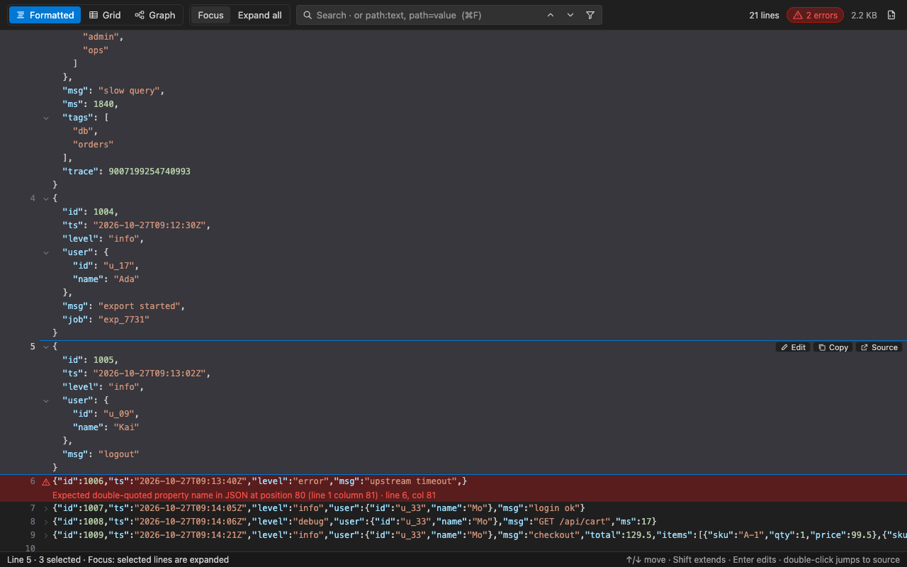
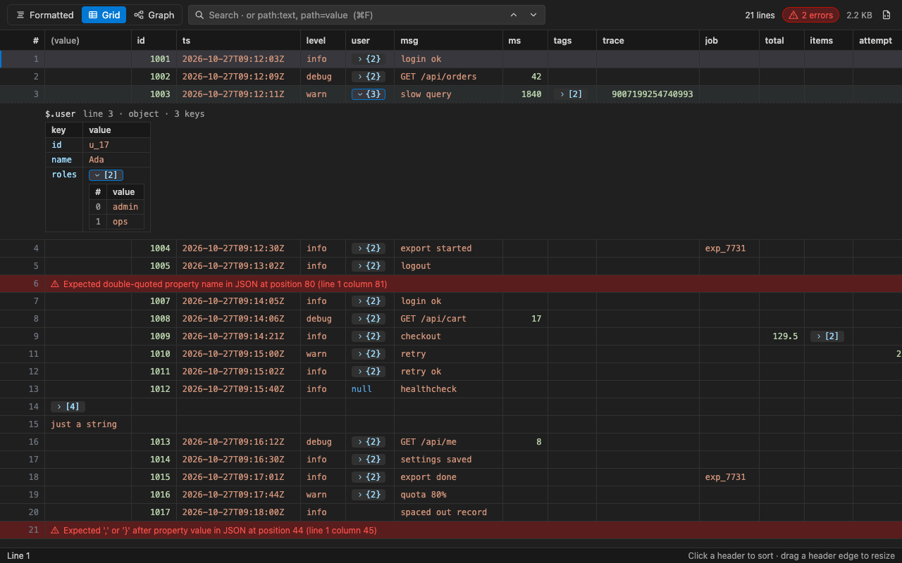
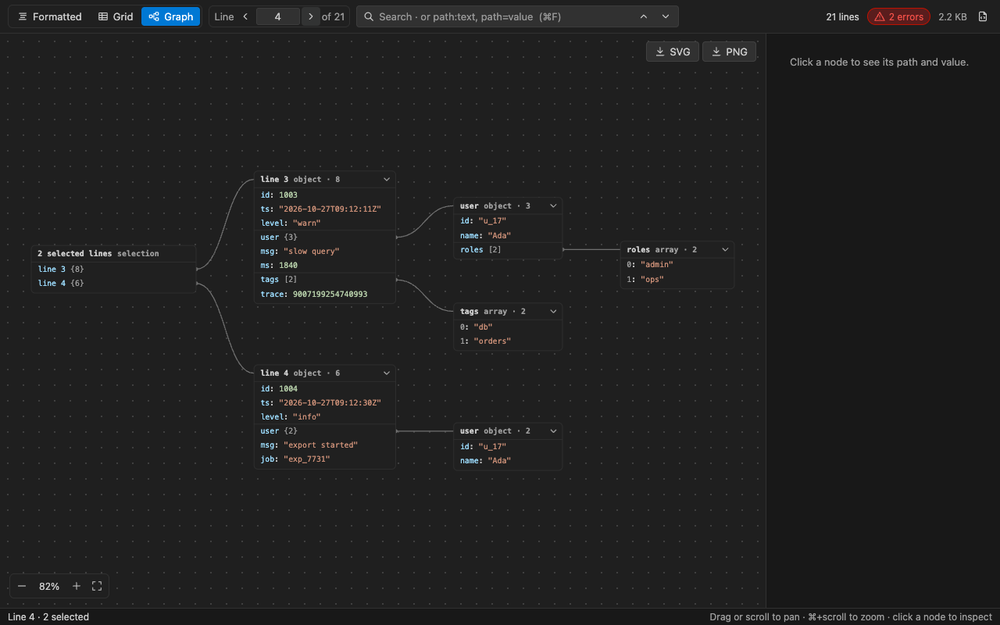

# Better JSONL

**One file, three views.** View JSON and JSON Lines (`.jsonl`, `.ndjson`) as formatted cards, a nested grid, or a node graph — side by side with your editor and synced to your cursor.



## Install

Download `better-jsonl-<version>.vsix` from the [GitHub Releases](../../releases) page, then either:

- In VS Code: Extensions view → `…` menu → **Install from VSIX…**, or
- In a terminal: `code --install-extension better-jsonl-<version>.vsix`

## Features

### Formatted view (default)

- **JSONL Focus mode** — every line stays on one line, and only the current or selected lines are pretty-printed. Move the cursor in the text editor and the preview follows.
- **JSONL Expand all mode** — every line is pretty-printed.
- Fold and unfold any object or array.
- Invalid lines get a red mark with the line and column of the error. Other lines are not affected.
- Large integers (for example `9007199254740993`) are shown exactly as written.
- Edit one record in a pretty-printed editor. It is saved back as one compact line.
- Double-click any line to jump to that member in the source.
- **Word wrap**: press `Alt+Z` (`Option+Z` on macOS) in the view, or use the wrap button in the toolbar. Wrapped parts of a pretty line keep its indent.

### Grid view

- One row per record. The columns are all top-level keys.
- Nested objects and arrays open as sub-grids under the row, starting under the column you opened. Arrays of objects show as tables.
- Word wrap (`Alt+Z`) wraps long cell values.
- Sort by any column. Drag a header edge to resize.



### Graph view

- Objects and arrays are nodes. Nested values are child nodes, linked from their row.
- Pan, zoom, fit, fold nodes, and search.
- Click a node to see its JSONPath and value. Reveal it in the editor, or copy it.
- Select several JSONL lines to compare them in one graph.
- Export as SVG or PNG.



### Search and filter

Type plain text, or a path query:

| Query | Meaning |
|-------|---------|
| `timeout` | Lines that contain the text |
| `level=warn` | `level` equals `warn` |
| `user.name:ada` | `user.name` contains `ada` |
| `ms>100` | Numeric compare (`>` or `<`) |
| `level!=info` | Not equal |

In the Formatted view, the filter button shows only the matching lines.

### Settings panel

Click the gear at the top right of the view. The panel changes the same settings as the VS Code Settings editor (they are saved to your user settings):

- **Theme**: Follow VS Code, Light, Dark, or Follow system (the operating system's light or dark mode).
- **Word wrap**: Follow editor (`editor.wordWrap`), On, or Off.
- Indent, default view, default JSON Lines mode, graph node limit, editor sync, Format Document for JSONL, and the Expand Selected Lines reminder.

## How to open

Right-click inside a JSON/JSONL editor, on its tab, or on the file in the Explorer. The commands are at the top level of the menu:

| Command | What it does |
|---------|--------------|
| **Better JSONL: Open Preview to the Side** | Opens the viewer beside the text editor. It follows the active JSON/JSONL editor and syncs the cursor. Also: the prism button at the top right of the editor (it is placed first, so a full title bar does not hide it), or `Cmd/Ctrl+K J`. |
| **Better JSONL: Open Full View** | Opens the viewer in place of the text editor. Save and undo still work. |

All commands are also in the Command Palette under `Better JSONL: …`.

## Commands for the text editor

| Command | What it does |
|---------|--------------|
| **Better JSONL: Expand Selected Lines** (right-click menu) | Pretty-prints the selected JSONL lines in place. It uses the editor's own indentation (Tab Size, spaces or tabs). A reminder then offers **Compact Lines**; choose **Don't Show Again** to turn it off. |
| **Better JSONL: Compact Lines** (right-click menu) | Turns the selection (or the whole file) back into one record per line. Nothing changes if any record is invalid. |
| **Format Document** on a `.jsonl` file | Off by default: Format Document does not change JSONL files. Turn on `betterJsonl.formatDocument.enabled` to make each line compact and canonical. It never expands records, because that would break the JSONL format. |

## Settings

| Setting | Default | Description |
|---------|---------|-------------|
| `betterJsonl.defaultView` | `formatted` | The first view: `formatted`, `grid` or `graph`. |
| `betterJsonl.theme` | `vscode` | `vscode` (follow VS Code), `light`, `dark`, or `system` (follow the operating system). |
| `betterJsonl.wordWrap` | `followEditor` | `followEditor` (use `editor.wordWrap`), `on`, or `off`. `Alt+Z` toggles it in the open view. |
| `betterJsonl.jsonl.expandMode` | `focus` | `focus` or `all`. |
| `betterJsonl.indent` | `2` | Spaces per indent level in the viewer and the record editor. |
| `betterJsonl.graph.maxNodes` | `1500` | The graph stops adding nodes after this number. |
| `betterJsonl.preview.followActiveEditor` | `true` | The preview switches to the JSON/JSONL editor that becomes active. |
| `betterJsonl.syncSelection` | `true` | Sync the current line between the text editor and the view. |
| `betterJsonl.expandLines.showReminder` | `true` | After Expand Selected Lines, remind that the file is not valid JSONL until compacted. |
| `betterJsonl.formatDocument.enabled` | `false` | Let Format Document compact each line of a JSONL file. When off, Format Document does not change JSONL files. |

## Limits

- VS Code does not give extensions files larger than 50 MB. Open those files as text.
- `.json` files with comments or trailing commas are parsed as JSON with Comments.
- A `.json` file with one JSON value per line is shown as JSON Lines.

## Development

```bash
npm install
npm run build        # dist/extension.js, dist/webview.js, dist/webview.css
npm run test:e2e     # VS Code host tests + packaged-VSIX UI checks + webview tests in Chrome → test-results/report.html
npm run package      # dist-vsix/better-jsonl-<version>.vsix
```

## Continuous integration and releases

GitHub Actions (`.github/workflows/ci.yml`) runs on every push and pull request, on macOS:

1. Extension host E2E tests (a downloaded VS Code).
2. Packages the VSIX and runs the UI checks against it in a real VS Code window.
3. Webview E2E tests in Chrome.

The VSIX and the E2E report are uploaded as build artifacts.

To publish a release, set `version` in `package.json`, commit, then push a matching tag:

```bash
git tag v0.2.0
git push origin v0.2.0
```

The workflow checks that the tag matches the version, runs the tests, and attaches the tested VSIX to a new GitHub Release.

## License

MIT
